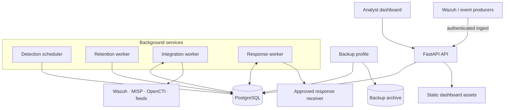

# AegisSOC

[](https://github.com/TheRootBaba/aegissoc/actions/workflows/tests.yml)

AegisSOC is a self-hosted security operations platform for collecting events, investigating alerts and managing approved response actions. The project is aimed at local labs and development environments. It is **not a certified production SIEM**.

**Maintainer:** BABA AHMED EL BEKAY

## What it does

| Area | Included functionality |
|---|---|
| Event ingestion | Canonical event API, source normalizers, Wazuh alert ingestion, bounded bulk ingestion and replay protection |
| Investigation | Event search, filters, saved queries, alert evidence and pivots across related entities |
| Detection | Built-in rules, ATT&CK metadata, a documented Sigma subset, event-count correlation and scheduled runs |
| Incident handling | Alert lifecycle, analyst notes, cases, linked evidence and audit history |
| Threat intelligence | Local IOC registry, MISP and OpenCTI adapters, source provenance, expiry and analyst revocation |
| Asset risk | Asset inventory and imports from Nessus, Tenable and Qualys scanner exports |
| Response | Approval-gated requests, separate execution, signed webhook delivery, idempotency and receiver reconciliation |
| Workspace security | Membership-based workspace selection, ORM scoping, PostgreSQL RLS and workspace-aware workers |
| Operations | Separate scheduler, retention, integration and response workers; health checks, backup verification and structured logs |
| Identity | Local accounts, optional pre-provisioned OIDC identities and environment/file-backed secret references |

A few limits are worth calling out:

- Scanner integrations import existing exports; they do not launch scans.
- Sigma support is limited to the syntax described in the [detection guide](docs/SIGMA_DETECTION.md).
- Response actions are sent to a configured receiver. AegisSOC does not directly isolate endpoints or execute commands on them.
- Provider support depends on API versions, permissions and response formats. A passing fixture test is not provider certification.

## How it is put together

The API serves the dashboard and handles user requests. PostgreSQL is the system of record. Background workers poll integrations, run scheduled detections, apply retention policies and deliver approved response requests.



The [platform architecture guide](docs/PLATFORM_ARCHITECTURE.md) covers request flow, workspace boundaries, provider behavior, response handling and failure cases.

## Run it locally

The documented setup targets Windows 10/11 with WSL2 and Docker Desktop using the WSL2 backend. Git is also required. Python 3.12 is needed if you want to run the test suite on the host.

1. Create `.env` from the example if you do not already have one:

   ```powershell
   if (-not (Test-Path .env)) {
       Copy-Item .env.example .env
   } else {
       Write-Host ".env already exists; leaving it unchanged."
   }
   ```

2. Review `.env` and set unique local values for `POSTGRES_PASSWORD`, `RUNTIME_DB_PASSWORD` and `AUTH_SECRET_KEY`. If you reuse an initialized PostgreSQL volume, `POSTGRES_PASSWORD` must still match the password stored for the database owner role. Editing the environment file does not change an existing database role password. Keep `.env` out of Git.

3. Build and start the default stack:

   ```powershell
   docker compose up --build -d
   docker compose ps
   ```

   Wait for the API health check to pass. On startup, the API applies pending Alembic migrations with the migration-owner connection, then serves requests through the restricted runtime database role. Workers wait for API readiness.

   The default stack does not need Wazuh. To connect the integration worker to an existing Wazuh single-node Docker network, create that network and the local CA bundle first, then use the optional override described in [Integration adapters](docs/INTEGRATIONS.md):

   ```powershell
   docker compose -f compose.yaml -f compose.wazuh.yaml up --build -d
   ```

   Keep `wazuh-api-ca-bundle.pem` and provider credentials on your machine. Do not commit them.

4. Create the first administrator:

   ```powershell
   docker compose exec api python -m scripts.create_admin
   ```

5. Open the dashboard at [http://localhost:8000/dashboard](http://localhost:8000/dashboard). The API reference is at [http://localhost:8000/docs](http://localhost:8000/docs). Health endpoints are available at `/health/live` and `/health/ready`.

6. Check migration and worker status:

   ```powershell
   docker compose exec api alembic current
   docker compose exec api alembic heads
   docker compose logs --tail 80 api scheduler retention-worker integration-worker response-worker
   ```

Use `docker compose down` to stop the stack without deleting its data. **Do not run `docker compose down -v` unless you intend to remove the database and backup volumes.**

## Try a synthetic event

Use a dedicated lab workspace and synthetic data. First sign in with a local account and keep the password out of shell history and source files:

```powershell
$username = Read-Host "AegisSOC username"
$securePassword = Read-Host "AegisSOC password" -AsSecureString
$password = [System.Net.NetworkCredential]::new("", $securePassword).Password
$loginBody = @{ username = $username; password = $password } | ConvertTo-Json
$login = Invoke-RestMethod -Method Post -Uri "http://localhost:8000/api/v1/auth/login" -ContentType "application/json" -Body $loginBody
$headers = @{ Authorization = "Bearer $($login.access_token)" }
Remove-Variable password, loginBody, securePassword
```

Then send a test event:

```powershell
$body = @{
  source = "lab-manual"
  external_id = "demo-ssh-failure-001"
  event_type = "authentication.failure"
  severity = "high"
  timestamp = (Get-Date).ToUniversalTime().ToString("o")
  hostname = "ubuntu-lab"
  source_ip = "192.0.2.25"
  username = "analyst"
  message = "Synthetic failed SSH login for detection testing."
  raw = @{ synthetic = $true; scenario = "ssh-failures" }
} | ConvertTo-Json -Depth 5

Invoke-RestMethod -Method Post -Uri "http://localhost:8000/api/v1/events" `
  -Headers $headers -ContentType "application/json" -Body $body
```

The API contract and source-specific examples are available in the OpenAPI page and integration guides.

For a reviewer walkthrough and genuine application screenshots, see [Demo and screenshot capture](docs/DEMO_CAPTURE.md). Use synthetic data for captures; do not present mockups as screenshots of the running product.

## Documentation

### Architecture and development
- [Platform architecture and data flows](docs/PLATFORM_ARCHITECTURE.md)
- [Workspace identity and PostgreSQL RLS](docs/WORKSPACE_IDENTITY.md)
- [Integration runtime](docs/INTEGRATION_RUNTIME.md)
- [Worker scaling](docs/SCALING_AND_WORKERS.md)
- [Dashboard design system](docs/DESIGN_SYSTEM.md)

### Detection and response
- [Sigma detection](docs/SIGMA_DETECTION.md)
- [Threat intelligence and IOC handling](docs/THREAT_INTELLIGENCE.md)
- [Threat-feed synchronization](docs/THREAT_FEED_SYNC.md)
- [Vulnerability scanner imports](docs/VULNERABILITY_IMPORTS.md)
- [Asset risk and playbooks](docs/ASSET_RISK_AND_PLAYBOOKS.md)
- [Response action governance](docs/RESPONSE_GOVERNANCE.md)
- [Incident response](docs/INCIDENT_RESPONSE.md)

### Running and reviewing the project
- [Native integrations](docs/INTEGRATIONS.md)
- [Operations, backup and recovery](docs/OPERATIONS_RUNBOOK.md)
- [Demo and screenshot capture](docs/DEMO_CAPTURE.md)
- [Screenshot gallery](docs/SCREENSHOT_GALLERY.md)
- [Release readiness](docs/RELEASE_READINESS.md)
- [Contributor guide](CONTRIBUTING.md)
- [Security reporting](SECURITY.md)
- [Support policy](SUPPORT.md)
- [Changelog](CHANGELOG.md)

## Run the tests

Create a Python 3.12 environment and install the project requirements:

```powershell
py -3.12 -m venv .venv
.\.venv\Scripts\Activate.ps1
python -m pip install --upgrade pip
pip install -r requirements.txt
pytest -q
```

CI also checks PostgreSQL migrations, runtime-role setup, row-level security, dashboard JavaScript syntax and Docker Compose configuration. SQLite-backed unit tests are useful for quick feedback, but they do not prove PostgreSQL RLS isolation.

## Security and deployment notes

- Do not commit `.env`, tokens, private keys, real logs, production screenshots or customer telemetry.
- Use PostgreSQL and the dedicated non-owner runtime role for workspace isolation.
- Keep migration-owner credentials separate from application runtime credentials.
- OIDC identities must be provisioned by an administrator; unknown external identities are not created automatically.
- The audit hash chain is tamper-evident inside the database trust boundary. It is not an external immutable archive.
- Before using AegisSOC in production, complete the remaining work in the [release checklist](docs/RELEASE_READINESS.md), including an independent security review, load testing, restore drills, secrets rotation and provider validation.

## Evidence

The [screenshot gallery](docs/SCREENSHOT_GALLERY.md), [screenshot index](evidence/README.md) and [runtime verification index](docs/evidence/README.md) contain captures and lab evidence. Each item reflects the environment and date when it was collected; none should be read as production certification.
