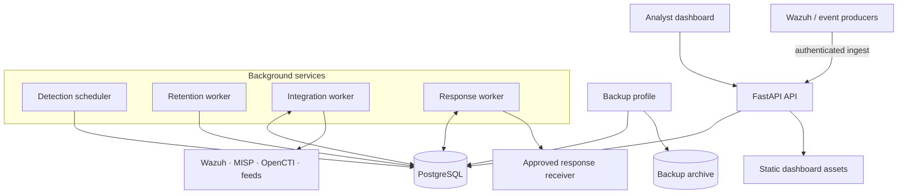

# AegisSOC

A local-first security operations platform for collecting security telemetry, investigating alerts and coordinating controlled response. The repository is an actively developed engineering project and lab deployment. It is **not a certified production SIEM**.

## What is implemented

| Area | Current implementation |
|---|---|
| Ingestion | Canonical event API, source normalizers, native Wazuh alert ingestion, bounded bulk ingestion and replay protection |
| Investigation | Event search, structured filters, saved queries, alert evidence and cross-source entity pivots |
| Detection | Deterministic starter detections, ATT&CK metadata, governed Sigma subset, bounded event-count correlation and scheduled execution |
| Incident workflow | Alert lifecycle, analyst notes, incident cases, linked evidence and audit history |
| Threat intelligence | Local IOC registry, MISP and OpenCTI feed adapters, provenance, expiry and analyst revocation |
| Asset risk | Managed asset inventory and scanner export imports for Nessus, Tenable and Qualys |
| Response | Approval-gated response requests, separate execution, signed webhook delivery, idempotency and receiver reconciliation |
| Workspace security | Membership-based workspace selection, ORM scoping, PostgreSQL RLS and workspace-aware background workers |
| Operations | Separate scheduler, retention, integration and response workers; health endpoints; backup verification; structured logs |
| Identity | Local accounts and optional pre-provisioned OIDC identities; environment/file-backed secret references |

Provider compatibility still depends on the API version, permissions and response shape of the target installation. Scanner imports normalize exports; they do not run scans. Sigma support is a documented subset, not a complete Sigma backend. Response actions are sent to a configured receiver; AegisSOC does not directly isolate endpoints or execute arbitrary commands.

## Architecture

The API handles authenticated requests and serves the dashboard. PostgreSQL is the system of record. Background workers run independently so polling, detection schedules, retention and response delivery do not execute inside analyst-facing request handlers.



For the request flow, tenant boundary, provider behavior, response lifecycle and failure handling, see [Platform architecture](docs/PLATFORM_ARCHITECTURE.md).

## Run locally with Docker Desktop

Requirements: Windows 10/11, WSL2, Docker Desktop using the WSL2 backend, and Git. Python 3.12 is needed for running the test suite outside Docker.

1. Create the local environment file only if it does not already exist:

   ```powershell
   if (-not (Test-Path .env)) {
       Copy-Item .env.example .env
   } else {
       Write-Host ".env already exists; preserving its credentials."
   }
   ```

2. Review `.env`. Set unique local values for `POSTGRES_PASSWORD`, `RUNTIME_DB_PASSWORD` and `AUTH_SECRET_KEY`. When reusing an initialized PostgreSQL volume, the `POSTGRES_PASSWORD` value must match the password already stored for the database owner role; changing the environment file does not rotate a role password inside an existing database. Keep `.env` private.

3. Build and start the stack:

   ```powershell
   docker compose up --build -d
   docker compose ps
   ```

   Wait for `api` to report healthy. The API startup applies pending Alembic migrations using the migration-owner connection and then serves traffic through the restricted runtime database role. Worker services wait for API readiness.

   The base stack does not require a Wazuh installation. To attach the integration worker to an existing Wazuh Docker single-node network, first create the network and local CA bundle, then use the optional override documented in [Integration adapters](docs/INTEGRATIONS.md):

   ```powershell
   docker compose -f compose.yaml -f compose.wazuh.yaml up --build -d
   ```

   Keep `wazuh-api-ca-bundle.pem` and provider credentials local; never commit them.

4. Create the first administrator interactively:

   ```powershell
   docker compose exec api python -m scripts.create_admin
   ```

5. Open the dashboard at [http://localhost:8000/dashboard](http://localhost:8000/dashboard). API reference: [http://localhost:8000/docs](http://localhost:8000/docs). Health checks: `/health/live` and `/health/ready`.

6. Check migration and worker state:

   ```powershell
   docker compose exec api alembic current
   docker compose exec api alembic heads
   docker compose logs --tail 80 api scheduler retention-worker integration-worker response-worker
   ```

Stop the services with `docker compose down`. This preserves the named database volume. **Do not use `docker compose down -v` unless you intentionally want to delete the local database and backup volumes.**

## Synthetic event walkthrough

Use a dedicated lab workspace and synthetic data only. After signing in, ingest one test event:

```powershell
$body = @{
  source = "lab-manual"
  external_id = "demo-ssh-failure-001"
  event_type = "authentication.failure"
  severity = "high"
  timestamp = (Get-Date).ToUniversalTime().ToString("o")
  hostname = "ubuntu-lab"
  source_ip = "192.0.2.25"
  username = "analyst"
  message = "Synthetic failed SSH login for detection testing."
  raw = @{ synthetic = $true; scenario = "ssh-failures" }
} | ConvertTo-Json -Depth 5

Invoke-RestMethod -Method Post -Uri "http://localhost:8000/api/v1/events" `
  -Headers $headers -ContentType "application/json" -Body $body
```

First obtain a token (use your local lab account; do not hard-code or commit a real password):

```powershell
$username = Read-Host "AegisSOC username"
$securePassword = Read-Host "AegisSOC password" -AsSecureString
$password = [System.Net.NetworkCredential]::new("", $securePassword).Password
$loginBody = @{ username = $username; password = $password } | ConvertTo-Json
$login = Invoke-RestMethod -Method Post -Uri "http://localhost:8000/api/v1/auth/login" -ContentType "application/json" -Body $loginBody
$headers = @{ Authorization = "Bearer $($login.access_token)" }
Remove-Variable password, loginBody, securePassword
```

Then run the event-ingestion example above. The API contract and source-specific examples are documented in the OpenAPI page and integration guides.

For a reviewer walkthrough and screenshots captured from the real application, follow [Demo and screenshot capture](docs/DEMO_CAPTURE.md). Do not use generated UI mockups or screenshots containing customer data as product evidence.

## Engineering documentation

- [Platform architecture and data flows](docs/PLATFORM_ARCHITECTURE.md)
- [Platform phases 1.30b–1.34 and remaining roadmap](docs/PLATFORM_COMPLETION_1_30B_1_34.md)
- [Workspace identity and PostgreSQL RLS](docs/WORKSPACE_IDENTITY.md)
- [Integration runtime](docs/INTEGRATION_RUNTIME.md)
- [Native integrations](docs/INTEGRATIONS.md)
- [Threat-feed synchronization](docs/THREAT_FEED_SYNC.md)
- [Threat intelligence and IOC handling](docs/THREAT_INTELLIGENCE.md)
- [Vulnerability scanner imports](docs/VULNERABILITY_IMPORTS.md)
- [Sigma detection engineering](docs/SIGMA_DETECTION.md)
- [Response action governance](docs/RESPONSE_GOVERNANCE.md)
- [Worker scaling](docs/SCALING_AND_WORKERS.md)
- [Operations, backup and recovery](docs/OPERATIONS_RUNBOOK.md)
- [Dashboard design system](docs/DESIGN_SYSTEM.md)
- [Demo and screenshot capture](docs/DEMO_CAPTURE.md)

## Development checks

Create and activate a Python 3.12 environment, then install the development requirements:

```powershell
py -3.12 -m venv .venv
.\.venv\Scripts\Activate.ps1
python -m pip install --upgrade pip
pip install -r requirements.txt
pytest -q
```

The CI workflow also validates PostgreSQL migrations and RLS behavior, runs the API tests, and checks dashboard JavaScript syntax. SQLite-backed unit tests are useful for fast regression feedback; use the PostgreSQL CI checks to validate RLS enforcement.

## Security notes

- Never commit `.env`, tokens, real logs, production screenshots or exported customer telemetry.
- Use PostgreSQL and the dedicated non-owner runtime role for workspace isolation.
- Keep migration-owner credentials separate from application runtime credentials.
- OIDC identities must be provisioned by an administrator; unknown external identities are not auto-created.
- The audit hash chain is tamper-evident within the database trust boundary, not an external immutable archive.
- Before a real production deployment, complete the remaining assurance work in the [platform roadmap](docs/PLATFORM_COMPLETION_1_30B_1_34.md), including independent security review, load testing, restore drills, secrets rotation and provider validation.

## Product evidence

See the [dashboard and API screenshot gallery](docs/SCREENSHOT_GALLERY.md) for genuine captures of the current interface, the related engineering guides, and recorded local walkthroughs. Screenshots are evidence of the captured environment and should not be read as a production certification.
