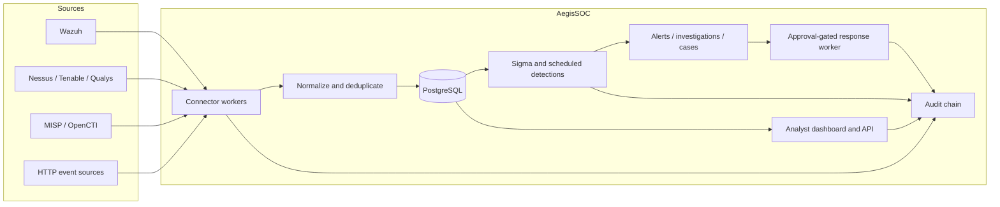
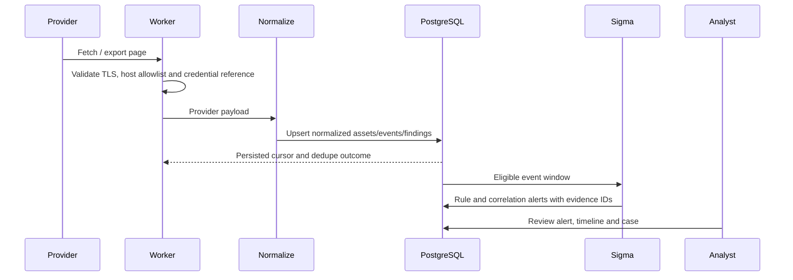
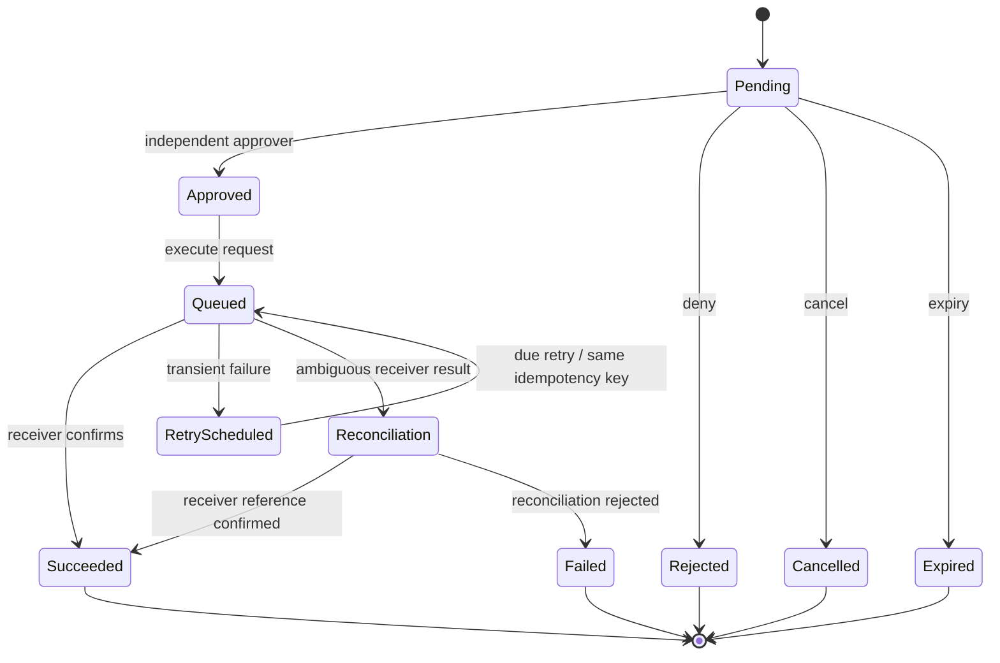
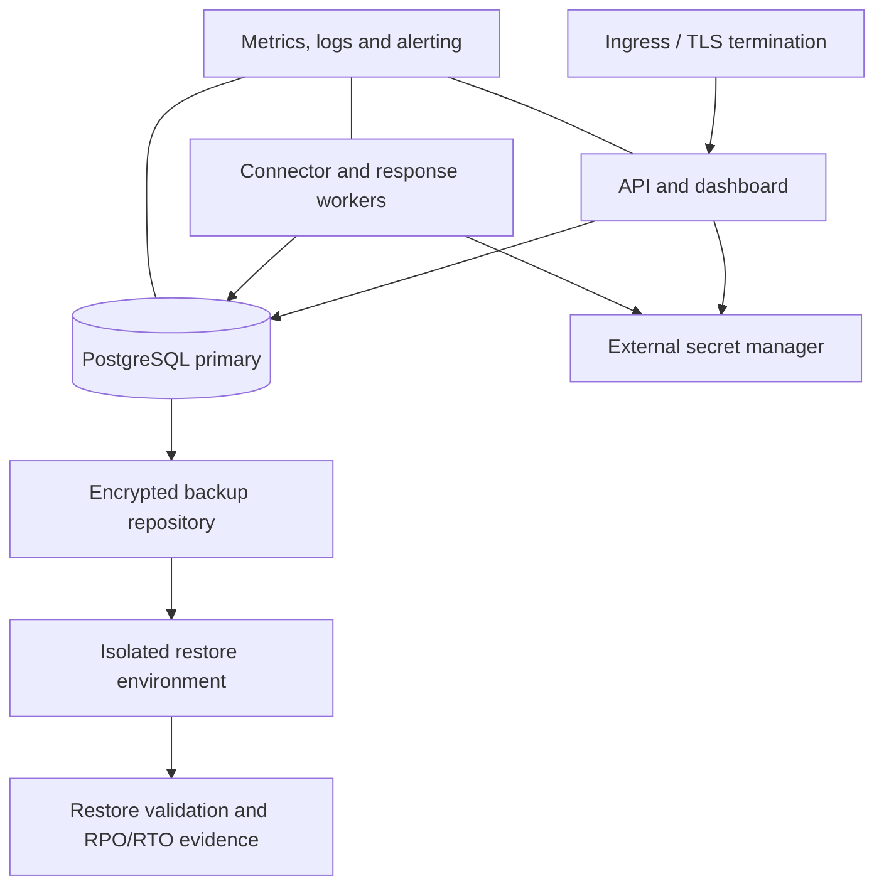

# AegisSOC Architecture

These diagrams describe the intended logical flow in the repository. They are source diagrams, not screenshots of a running deployment. Deployment-specific topology, provider endpoints, secrets and trust boundaries must be confirmed against the target environment.

## Platform components

## Ingestion and detection lifecycle

## Response lifecycle

## Deployment and recovery boundary

## Required deployment-specific validation

- Confirm network zones, ingress policy, egress allowlists, database access paths and secret-manager integration.
- Confirm backup encryption, retention, restore permissions and recovery-point/recovery-time objectives.
- Confirm HA/failover behavior and worker lease/retry behavior under node loss.
- Attach a redacted deployment diagram and evidence from the actual target environment before calling the system production-ready.
