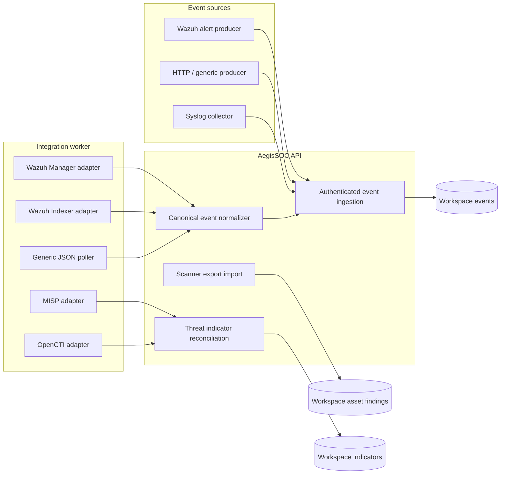

# Integration adapters

> Related product captures: [AegisSOC screenshot gallery](SCREENSHOT_GALLERY.md).

This page distinguishes inbound event contracts from outbound polling adapters. A connector record describes a configured source; it does not imply that AegisSOC is listening on every transport or can speak every vendor API.

## Adapter inventory

| Connector type | Direction | What the application does | Important limit |
|---|---|---|---|
| `wazuh` | Inbound | Accepts native Wazuh alert JSON and normalizes it into canonical events | The producer sends alerts to the AegisSOC ingestion API |
| `http_event` | Inbound | Accepts source-specific JSON through the authenticated ingestion API | Does not run an HTTP listener on a separate port |
| `generic` | Inbound | Accepts canonical or normalizable JSON events | Source must submit to the API |
| `syslog` | Forwarded | Stores validated host, port and transport metadata | A separate syslog collector must forward events; this service is not a syslog daemon |
| `http_poll` | Outbound | Polls an allowlisted JSON endpoint and normalizes event records | Generic JSON contract; provider pagination is not inferred |
| `threat_feed` | Outbound | Polls a JSON feed and reconciles IP, domain and hash indicators | Feed records must follow the documented normalized contract |
| `wazuh_manager` | Outbound | Authenticates to Wazuh Manager and polls alert records | Requires a compatible Manager API and scoped credentials |
| `wazuh_indexer` | Outbound | Searches Wazuh Indexer alerts with bounded pagination and persisted cursor | Requires Indexer access and a compatible search response |
| `misp` | Outbound | Polls MISP attributes and maps supported attribute types to indicators | Not every MISP object or attribute type is normalized |
| `opencti` | Outbound | Queries OpenCTI GraphQL indicators and maps supported STIX patterns | Only supported indicator patterns are converted |
| `response_webhook` | Outbound | Delivers approved response requests to an allowlisted receiver | Receiver must authenticate and enforce idempotency |

Nessus, Tenable and Qualys integrations in this release are scanner-export normalizers that feed the scanner import API. They do not claim to run authenticated scans or poll every scanner's export API.

## Data flow



## Credentials and network controls

Connector configuration is metadata. Put a secret reference in `credential_ref`, not the secret itself. The integration worker resolves supported references from its environment or mounted secret files. Do not put credentials in `config`, connector names, screenshots or logs.

Outbound requests use explicit hostname allowlists, bounded timeouts and response sizes, TLS verification, and disabled redirects. Wazuh Manager, Wazuh Indexer, MISP and OpenCTI adapters require HTTPS. Credentials should be scoped to read-only access where the provider supports it. Apply network egress restrictions outside the application as an additional control.

## Provider setup and validation

Provider-specific configuration is validated by the adapter before polling. A successful local configuration check is not proof that the remote endpoint is reachable or that the credential has sufficient permissions. Confirm connectivity and permissions in a controlled test workspace, then inspect execution history and last-success timestamps after enabling the connector.

Provider APIs evolve. Validate endpoint paths, auth behavior, pagination, cursor semantics, rate limits and response schemas against the version deployed by the operator. Add a fixture and regression test when a new response variant is accepted. Do not broaden parsing by silently guessing field names.

For polling limits, leases, retries and operational health, see [Integration runtime](INTEGRATION_RUNTIME.md) and [Worker execution and scaling](SCALING_AND_WORKERS.md).

## Optional Wazuh Docker lab network

The default `compose.yaml` deliberately does not depend on a Wazuh deployment. To connect the integration worker to the Wazuh Docker single-node stack, use the separate override after that stack has created its external Docker network and the trusted CA bundle exists locally:

```powershell
docker network inspect single-node_default
Test-Path .\wazuh-api-ca-bundle.pem
docker compose -f compose.yaml -f compose.wazuh.yaml config
docker compose -f compose.yaml -f compose.wazuh.yaml up --build -d
```

The override attaches only the integration worker to `single-node_default`, mounts `wazuh-api-ca-bundle.pem` read-only and sets `SSL_CERT_FILE`. Keep the CA bundle and all provider credentials local; they are not committed. If the Wazuh network or CA file is unavailable, use the base command in the root README without the override. To return to the standalone network configuration, recreate the stack with only `compose.yaml`.
