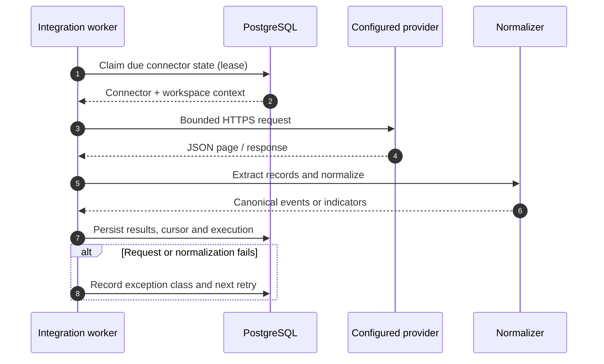

# Integration runtime

> Related product captures: [AegisSOC screenshot gallery](SCREENSHOT_GALLERY.md).

The integration worker performs outbound polling independently of the API. Connector configuration and execution history live in PostgreSQL; credentials are resolved by the worker from references rather than stored in connector JSON.

## Execution flow



## Supported outbound connectors

| Type | Authentication and behavior | Result |
|---|---|---|
| `http_poll` | JSON endpoint, exact hostname allowlist, optional supported auth header | Canonical events |
| `threat_feed` | JSON feed, optional supported auth header | IP/domain/hash indicators |
| `wazuh_manager` | HTTPS Manager API, referenced `username:password`, token exchange | Normalized Wazuh alert events |
| `wazuh_indexer` | HTTPS Indexer, referenced Basic Auth credential, bounded search pagination | Normalized Indexer alert events |
| `misp` | HTTPS REST API, referenced API key in the configured MISP auth header, paginated attributes | Supported IOC attributes |
| `opencti` | HTTPS GraphQL API, referenced token, cursor-based indicator query | Supported STIX-pattern indicators |

Inbound `wazuh`, `http_event`, `generic` and forwarded `syslog` contracts are described in [Integration adapters](INTEGRATIONS.md). They do not all represent background pollers.

## Connector configuration

Create connectors through the administrator-only `POST /api/v1/connectors` API. A connector includes a stable key, type, display name, non-secret configuration, optional `credential_ref` and enabled state. The exact configuration fields depend on the adapter. At minimum, outbound polling needs an HTTPS endpoint and an exact `allowed_hosts` list. Never embed credentials in a URL or connector JSON.

Secret references supported by the runtime are:

- `env://VARIABLE_NAME` — resolve from the worker process environment.
- `file:///run/secrets/NAME` — resolve from a mounted secret file under the allowed secret directory.

For local Compose, place the variable values in the untracked `.env` file or mount secret files deliberately. Ensure the integration worker receives the required values. Do not paste secrets into issue reports or logs.

## Request and parsing limits

- HTTPS is required for the native Wazuh, MISP and OpenCTI adapters.
- Exact hostname allowlists are checked before a request.
- Redirects are disabled and TLS certificate verification remains enabled.
- Request timeouts are bounded.
- Response bodies are streamed and capped at 5 MiB.
- Each poll is limited to 1,000 records.
- Provider-specific record extraction uses a configured or adapter-defined records path.
- Unsupported record shapes fail the execution; they are not silently treated as successful empty polls.

These controls bound resource use. They do not replace provider-side rate-limit policies, a production egress proxy or per-vendor contract testing.

## State, cursors and retries

The runtime stores per-connector state and execution history. A lease prevents ordinary concurrent claims; PostgreSQL `FOR UPDATE SKIP LOCKED` supports multiple worker replicas. Provider pagination state is persisted where the adapter implements a cursor/search-after contract. Failed executions record a sanitized exception class and bounded exponential backoff.

Event polling uses the canonical event ingestion path and its `(source, external_id)` replay protection. Threat-feed polling normalizes supported indicators and reconciles by indicator type/value. Analyst revocation is not undone by a later feed poll.

Inspect:

- `GET /api/v1/connectors/runtime-health` for aggregate worker/connector runtime state.
- `GET /api/v1/connectors/{connector_id}/executions` for per-connector execution history.
- The `integration-worker` container logs for process-level failures.

## Start the worker

```powershell
docker compose up --build -d db api
docker compose exec api alembic current
docker compose up -d integration-worker
docker compose logs -f integration-worker
```

Wait for the API to become healthy before starting the worker. Compose already declares that dependency for the normal full-stack startup.

## What this runtime does not promise

A valid connector configuration does not prove that the provider is reachable. The application does not claim every vendor API version, every MISP attribute, every OpenCTI STIX pattern, or every Wazuh deployment layout. Scanner import support is separate: Nessus, Tenable and Qualys exports are normalized through the scanner import contract, not polled as native live scanner jobs by this worker. Validate provider versions, permissions, pagination and rate-limit behavior in a non-production workspace before enabling scheduled polling.
