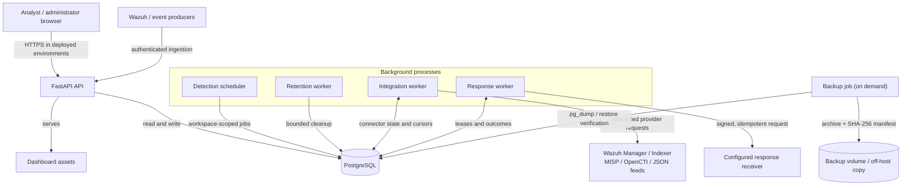
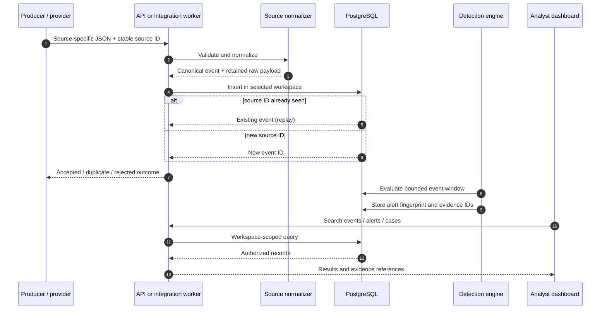
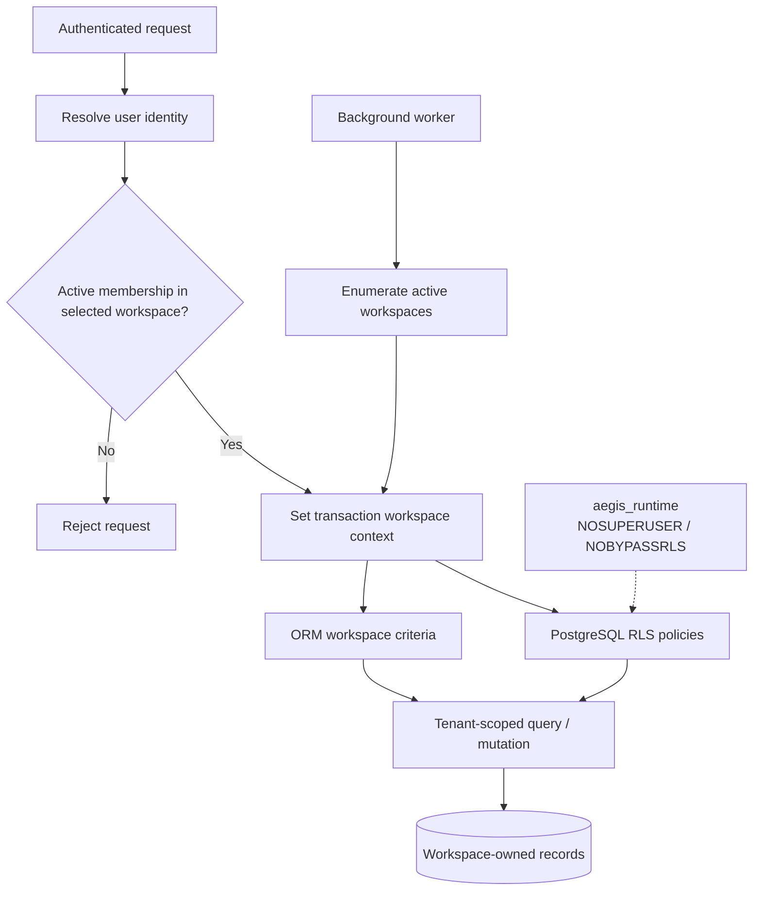
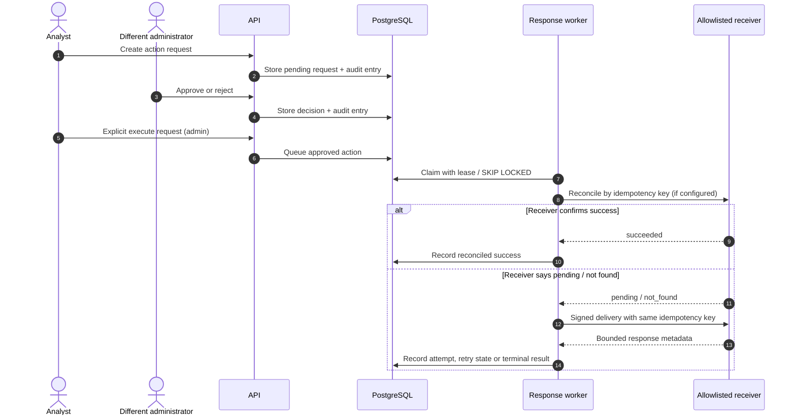

# AegisSOC platform architecture

This document describes the code that is in the repository today. It is an implementation map, not a target-state diagram. Provider-specific gaps and deployment requirements are called out where they matter.

## Runtime topology

The API serves the analyst dashboard and authenticated API. PostgreSQL is the system of record. The scheduler, retention worker, integration worker and response worker are separate processes; they share the database but have different responsibilities. In Compose, the API applies migrations and provisions a restricted runtime database role before it becomes healthy. The workers use that runtime role.

The Compose file currently defines one API, one PostgreSQL service, and separate scheduler, retention, integration and response worker services. The backup service is started through the `backup` profile. Scaling worker replicas is a deployment decision; PostgreSQL locking and leases coordinate claims, but CPU, memory, provider quotas and database capacity still set practical limits.

## Event ingestion and investigation

Canonical fields support cross-source search. The submitted source object is retained in `raw` so an analyst can inspect fields that are not part of the common schema. Event replay protection depends on a stable `(source, external_id)`; records without a stable external ID cannot be deduplicated by that key.

## Workspace isolation and database boundary

Workspace membership is resolved from the authenticated identity. The selected workspace is carried in the request context and is not trusted merely because a client supplied an ID. ORM scoping provides application-level filtering; PostgreSQL row-level security is the final data boundary for tenant-owned tables. The API and workers connect as a non-owner role without `BYPASSRLS`.

A workspace ID header is a selector, not an authorization grant. Membership checks and database policy must both permit access. Worker jobs enumerate workspaces and set an explicit context before processing tenant-owned rows. SQLite is used by parts of the fast unit-test suite, but it does not implement PostgreSQL RLS and is not evidence of database-level tenant isolation. The PostgreSQL RLS integration tests are the relevant check for that boundary.

## Provider integrations

The integration worker claims due connector work using persisted state and leases, performs bounded outbound requests, records execution history and advances the connector cursor/backoff state. Provider credentials are referenced rather than embedded in connector configuration. Supported secret reference forms are documented in the configuration and operations guides.

The native adapters currently cover:
- Wazuh Manager token authentication and alert polling.
- Wazuh Indexer alert search with bounded pagination and a persisted cursor.
- MISP attribute polling and pagination.
- OpenCTI GraphQL indicator polling and cursor pagination.
- Nessus, Tenable and Qualys export normalization into the scanner import contract.

The scanner import path consumes exports; it is not a universal authenticated scanner polling client for every product and deployment. Provider API versions, tenant-specific response shapes, rate limits and credential permissions still need validation against the target installations. The generic JSON poller remains a separate adapter contract, not a substitute for provider-specific behavior.

## Detection and alert evidence

The built-in deterministic rules and imported Sigma rules create records in the same alert model. Sigma YAML is safely parsed and validated against the implemented subset. The evaluator supports mapped fields, selector conditions, wildcard matching, selected string modifiers and bounded `event_count` correlation. It is not a full Sigma backend. Rules are disabled on import, should be tested against representative source events, and are enabled deliberately.

Alerts retain evidence event identifiers and stable fingerprints. Scheduled detection runs are executed by the scheduler worker; event sample size, lookback and rule count are bounded to keep execution predictable.

## Response execution

Approval and execution are separate operations, and self-approval is prohibited. AegisSOC sends a signed request to a configured receiver; it does not run shell commands or directly isolate endpoints. The receiver must validate the signature, authorize the target, enforce the idempotency key and retain its own execution audit. Reconciliation is only meaningful when the receiver implements the documented contract.

## Persistence, migrations and audit

Alembic owns schema changes. The current migration head is `0019_sigma_correlation`. The API startup path uses the migration-owner connection for schema changes and provisions/uses the restricted runtime role for normal application traffic. Workers use the runtime connection. Do not point production application traffic at the migration-owner account.

The security audit chain detects edits, deletion, reordering and broken hash linkage within the database trust boundary. It is not immutable against an administrator who can rewrite both the audit rows and chain state. Production deployments should export or anchor audit evidence outside the database's administrative boundary.

## Failure handling

| Failure | Persisted behavior | Operator action |
|---|---|---|
| Provider request fails | Execution result and bounded retry/backoff | Check provider status, credentials, allowlist and cursor |
| Worker exits mid-lease | Lease eventually expires and work can be reclaimed | Inspect worker logs and execution history |
| Producer retries an event | Stable source ID returns the existing event | Confirm producer ID stability |
| Response receiver outcome is uncertain | Reconciliation is attempted before another delivery | Check receiver idempotency/reconciliation implementation |
| Database is unavailable | API readiness fails; dependent workers wait | Preserve logs and volume, then follow the recovery runbook |
| Backup verification fails | Backup is not treated as verified | Keep prior backups; investigate restore validation |

## Operational and security boundaries

- Exact outbound hostname allowlists, HTTPS defaults, disabled redirects, TLS verification and bounded response sizes/timeouts apply to supported outbound HTTP paths.
- Raw secrets must not be placed in connector JSON, issue descriptions, screenshots or logs.
- OIDC is optional and requires administrator-provisioned issuer/subject mappings. It does not automatically create local accounts.
- PostgreSQL is required for the intended multi-workspace enforcement boundary.
- Local Compose is a controlled engineering environment, not a high-availability deployment or a production security certification.

## Related engineering documents

- [Workspace identity and isolation](WORKSPACE_IDENTITY.md)
- [Integration runtime](INTEGRATION_RUNTIME.md)
- [Vulnerability imports](VULNERABILITY_IMPORTS.md)
- [Threat-feed synchronization](THREAT_FEED_SYNC.md)
- [Sigma detection engineering](SIGMA_DETECTION.md)
- [Response action governance](RESPONSE_GOVERNANCE.md)
- [Worker scaling](SCALING_AND_WORKERS.md)
- [Operations and recovery](OPERATIONS_RUNBOOK.md)
- [Demo and screenshot capture](DEMO_CAPTURE.md)
