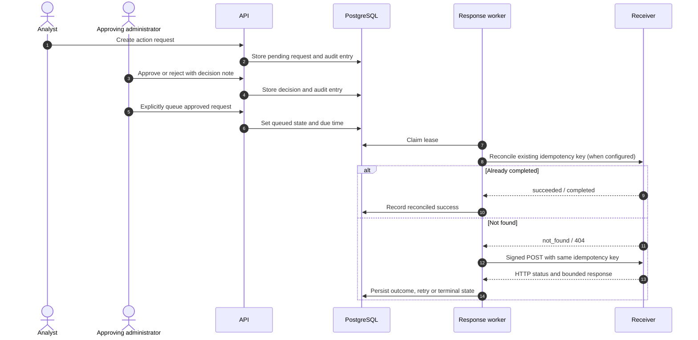

# Response action governance and execution

> Related product captures: [AegisSOC screenshot gallery](SCREENSHOT_GALLERY.md).

AegisSOC separates an analyst's request, an administrator's decision and the external delivery attempt. The application does not run shell commands or directly isolate endpoints. It sends a bounded request to an administrator-configured receiver.

## Request and approval path

The requester cannot approve their own action. Approval does not queue execution; an administrator must make a separate execute request. Supported action labels are `notify`, `block_ip`, `disable_user` and `isolate_host`. They are payload types for the configured receiver, not built-in endpoint-control functions. The `block_ip` target is validated as an IP address. Parameters are flat scalar values and secret-like keys are rejected.

## Receiver configuration

Register an enabled `response_webhook` connector with:

- An HTTPS endpoint (HTTP is only permitted when explicitly enabled for a controlled lab).
- An exact `allowed_hosts` list.
- An optional `credential_ref` using a supported secret reference.
- An optional `reconciliation_endpoint` on the same allowlisted host.

The request is signed with HMAC-SHA256 when a credential is configured. The signature is sent in `X-Aegis-Signature`; the stable idempotency key is sent in `Idempotency-Key` and the JSON body. Redirects are disabled and TLS verification remains enabled.

The receiver must verify the signature, validate the action and target against its own policy, enforce idempotency before performing side effects, and keep its own execution audit. Never connect a portfolio demo to a real production response system.

## Delivery, leases and retry

The dedicated `response-worker` claims due work with a 120-second lease. PostgreSQL uses `FOR UPDATE SKIP LOCKED` to coordinate concurrent workers. Delivery attempts are bounded to five; retry delay grows exponentially from 30 seconds and is capped at 30 minutes. Receiver response bodies are not retained as unbounded text; the worker records status metadata and sanitized error classes.

An expired in-flight lease is not proof that the receiver did nothing. When a reconciliation endpoint is configured, the worker checks the same idempotency key before another delivery. The endpoint must return a matching key and a supported status. A confirmed success is recorded without resending; pending work is deferred; a not-found result permits a retry with the original idempotency key. Reconciliation responses are limited to 64 KiB.

Without a receiver reconciliation endpoint, operators must resolve uncertain delivery with the receiver before manually retrying. Do not assume that a timeout means the action failed.

## API lifecycle

| Operation | Endpoint | Permission |
|---|---|---|
| List action requests | `GET /api/v1/response-actions` | Authenticated |
| Create a request | `POST /api/v1/response-actions` | Analyst or administrator |
| Approve a request | `POST /api/v1/response-actions/{id}/approve` | Administrator other than requester |
| Reject a request | `POST /api/v1/response-actions/{id}/reject` | Administrator |
| Queue an approved request | `POST /api/v1/response-actions/{id}/execute` | Administrator |

All state changes are audit logged. The response record includes request/decision identity, execution state, attempt count, response code, result summary, external reference and idempotency key. Secret material and arbitrary receiver response bodies are not copied into audit details.

## Safe test procedure

Use a local mock receiver that records the request, validates the HMAC and stores idempotency keys. Test duplicate delivery, a receiver timeout after accepting the action, a reconciliation success, a pending receiver state and a not-found retry. Verify that one idempotency key never causes the mock receiver to apply the same side effect twice. Only then consider connecting an approved non-production receiver.

## Action lifecycle controls

New requests receive a bounded expiry (24 hours by default; configurable from 5 minutes to 7 days). The worker expires pending or queued actions before delivery and records the transition in the audit chain. Administrators can cancel requests while they are pending or approved; a request already being submitted cannot be canceled safely because the receiver may have accepted it.

Set `dry_run: true` when creating a request to exercise approval and worker lifecycle without contacting the configured receiver. A dry run completes with `execution_status=simulated`, zero delivery attempts, and an audit entry. It is not evidence that the receiver can perform the action.

Cancellation is intentionally not described as rollback. Once a receiver has accepted an action, reversal requires a receiver-specific compensation contract and reconciliation. The current generic webhook contract does not claim that every action can be reversed.
