# AegisSOC screen gallery

Dashboard screenshots are organized under [`evidence/dashboard/`](../evidence/README.md). Runtime/API/test captures are indexed separately in [`docs/evidence/`](evidence/README.md).

These captures were supplied from a running AegisSOC dashboard. They are product evidence, not generated mock-ups. The API demo was recorded against the FastAPI OpenAPI page at `/docs`.

Before publishing screenshots from another environment, review them for account names, workspace identifiers, internal hostnames, IP addresses, tokens and customer data. Replace or redact sensitive captures at the source; do not blur evidence in a way that changes what the screen appears to show.

## Dashboard

| Screen | What it shows | Related guide |
|---|---|---|
| 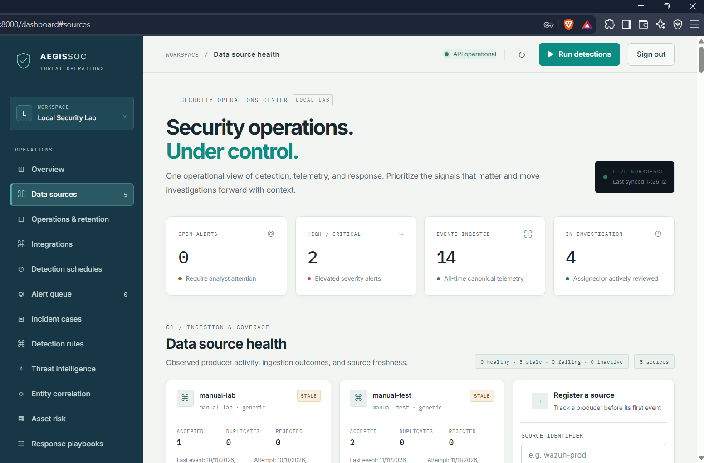 | Main analyst workspace and operational overview | [Platform architecture](PLATFORM_ARCHITECTURE.md) |
| 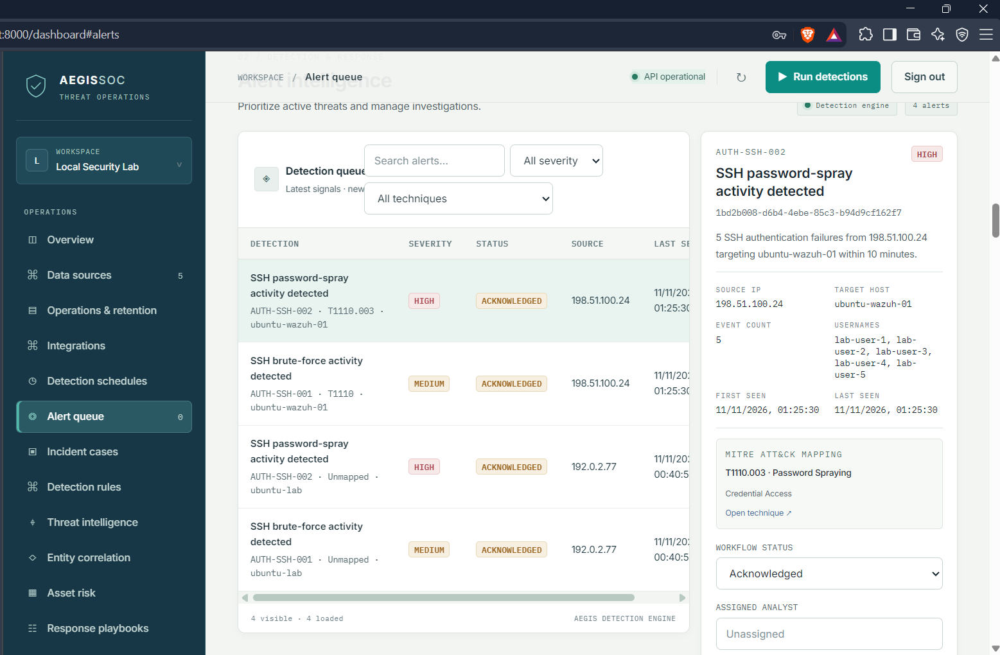 | Alert triage queue | [Incident response](INCIDENT_RESPONSE.md) |
| 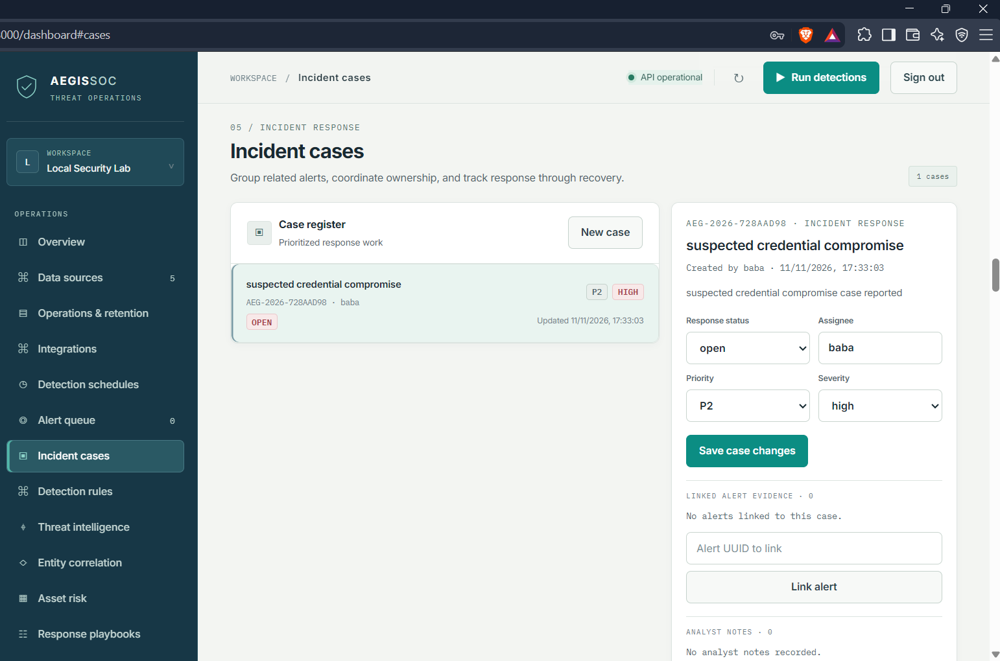 | Case tracking and linked investigation | [Incident response](INCIDENT_RESPONSE.md) |
| 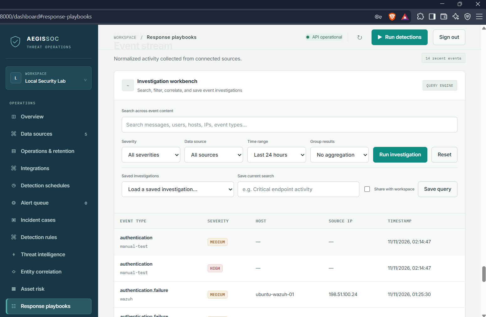 | Analyst investigation workspace | [Platform architecture](PLATFORM_ARCHITECTURE.md) |

## Detection and threat context

| Screen | What it shows | Related guide |
|---|---|---|
| 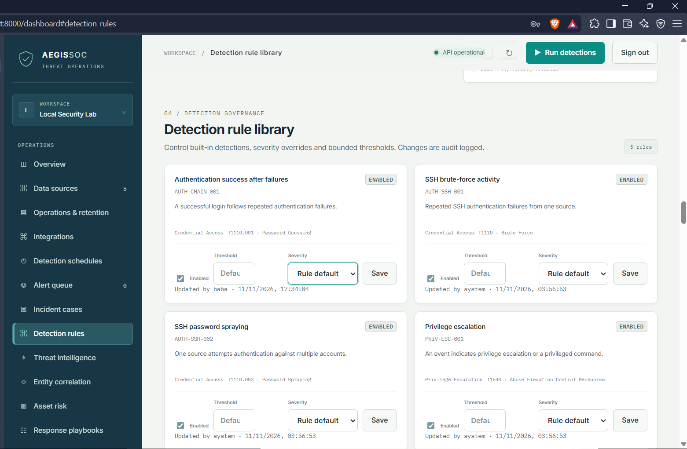 | Imported and managed detection rules | [Sigma detection](SIGMA_DETECTION.md) |
| 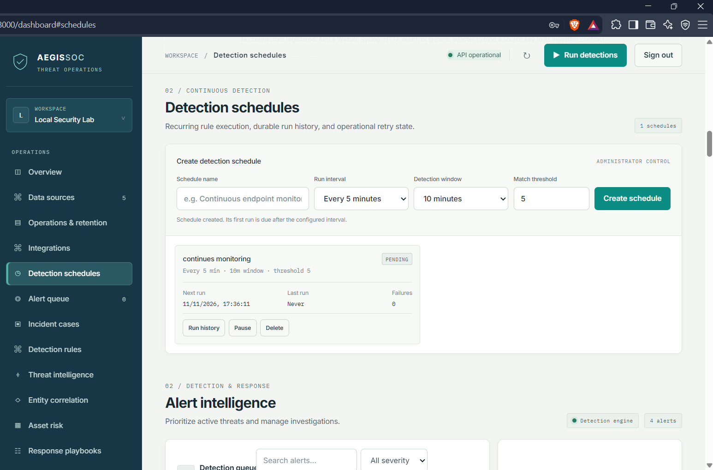 | Scheduled detection execution | [Scaling and workers](SCALING_AND_WORKERS.md) |
| 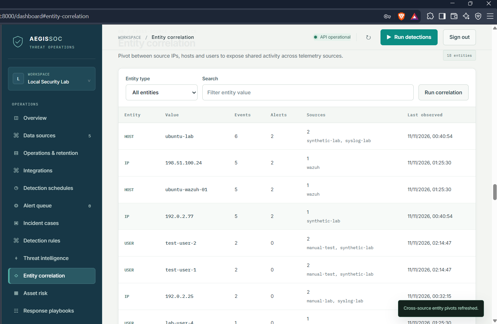 | Entity relationship view | [Platform architecture](PLATFORM_ARCHITECTURE.md) |
| 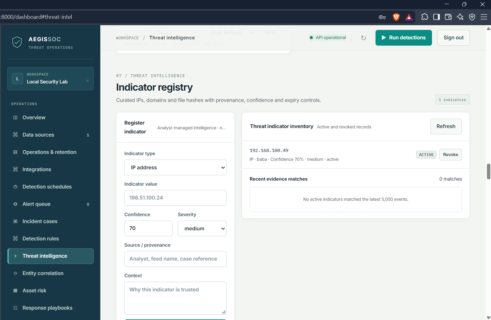 | IOC and threat-intelligence workspace | [Threat intelligence](THREAT_INTELLIGENCE.md) |

## Integrations and asset risk

| Screen | What it shows | Related guide |
|---|---|---|
|  | Configured integrations | [Integrations](INTEGRATIONS.md) |
| 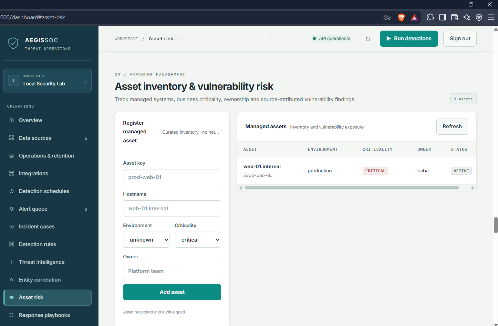 | Managed assets and vulnerability findings | [Asset risk and playbooks](ASSET_RISK_AND_PLAYBOOKS.md) |

## Response and administration

| Screen | What it shows | Related guide |
|---|---|---|
| 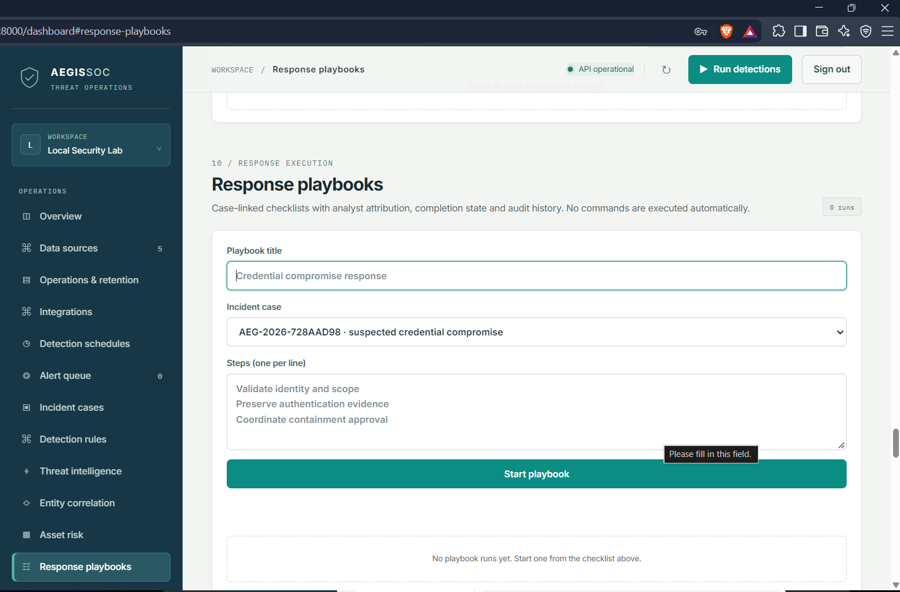 | Response playbook workflow | [Response governance](RESPONSE_GOVERNANCE.md) |
| 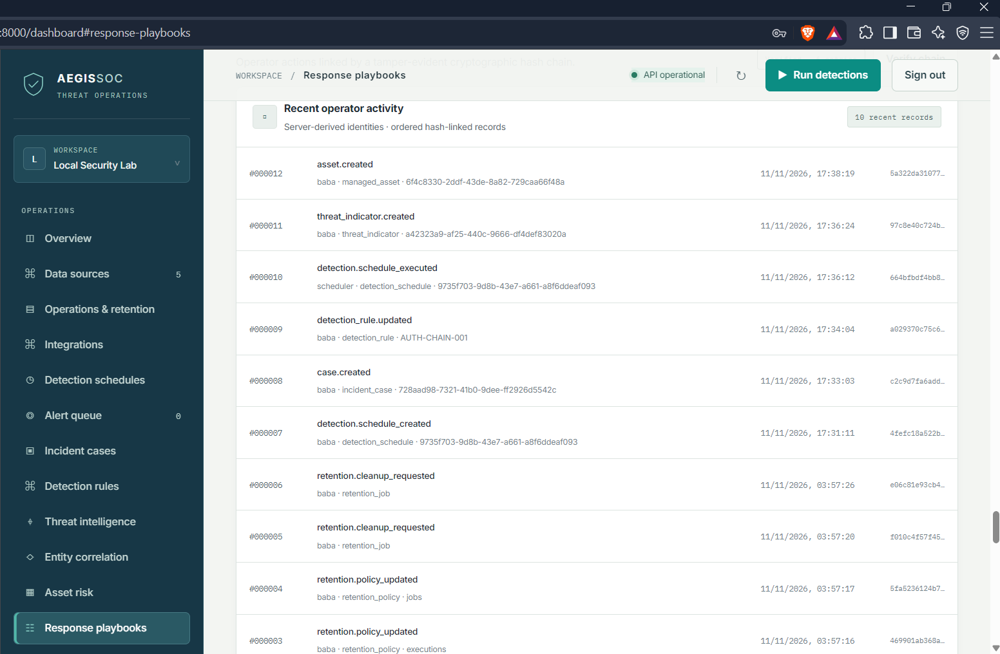 | Recorded administrative and analyst actions | [Operations runbook](OPERATIONS_RUNBOOK.md) |
| 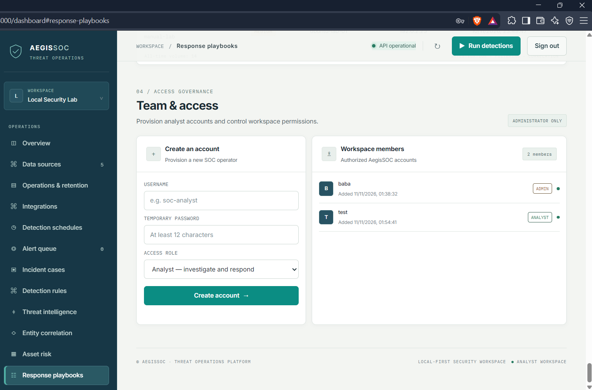 | Workspace membership and access | [Workspace identity](WORKSPACE_IDENTITY.md) |
| 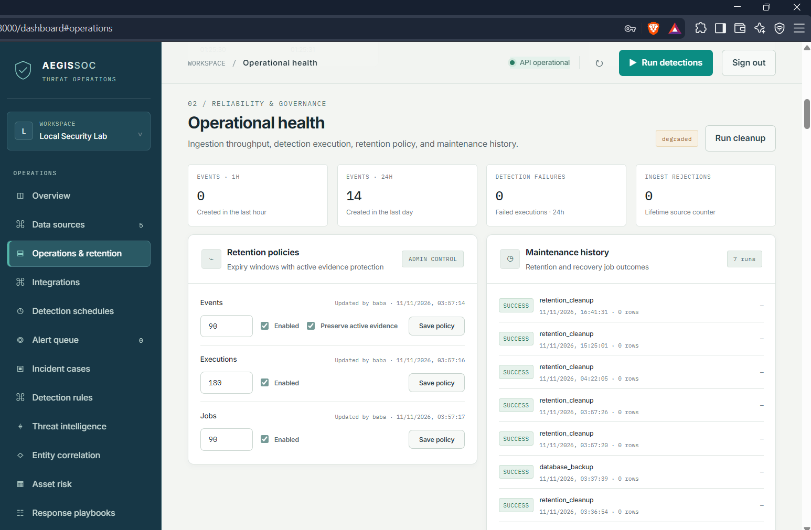 | Operational jobs and retention controls | [Operations runbook](OPERATIONS_RUNBOOK.md) |

## Local environment and recorded walkthroughs

The uploaded working copy also contains a Docker Desktop capture and two local recordings (dashboard and FastAPI `/docs`). Those three files are not yet part of the GitHub `main` branch, so this gallery deliberately does not link to missing repository paths. The Docker capture should accompany the local deployment guide; the dashboard recording belongs with this gallery; the API recording belongs with the API/integration guide. Add them as Git LFS objects or release assets rather than ordinary Git blobs if their size is material.

The API reference itself is served by the running application at `/docs`. A recording demonstrates the API browser; it does not replace endpoint schemas or versioned API behavior.

## Release-candidate capture status

The images above are genuine captures from a running dashboard, but this repository does not currently tie them to the release-candidate SHA. They must not be represented as release-build acceptance evidence until recaptured from the exact candidate build and entered in a capture manifest.

The following release-candidate views remain to be captured and reviewed: connector/source health, event detail, alert evidence, case timeline, scanner export job and imported findings, Sigma validation and correlation alert, response approval and reconciliation, workspace access enforcement, audit verification, and operations/backup health.

No release-build video files are currently committed or linked from this gallery. Follow [Release demo runbook](RELEASE_DEMO_RUNBOOK.md) to create the eight real walkthroughs and store large files as Git LFS objects or GitHub Release assets. The editable architecture diagrams are in [Architecture](ARCHITECTURE.md).

## Capture and maintenance

For repeatable captures from a signed-in local dashboard, see [Demo capture](DEMO_CAPTURE.md). Keep the original captures and replace them only with a newer recording from a known application revision. Add a caption and a link to the relevant engineering guide whenever a new screen is added. Record the release SHA, UTC time, environment, synthetic fixture version, redaction review and SHA-256 checksum for every release-candidate capture.
