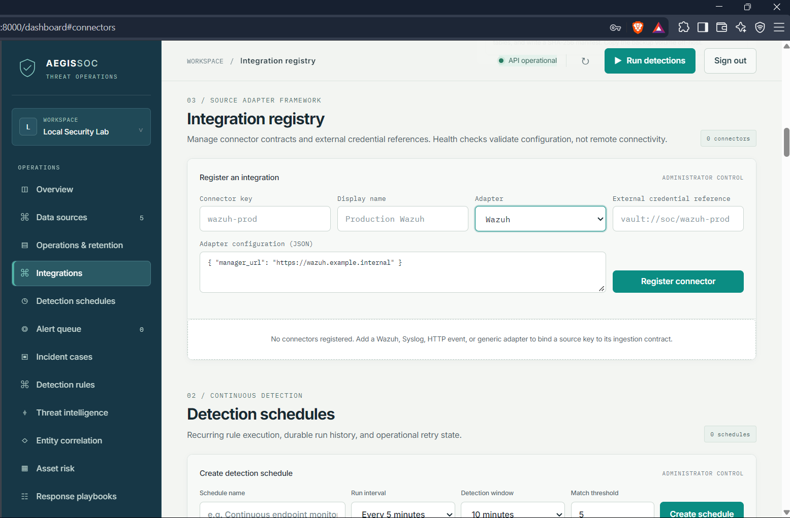

# AegisSOC screen gallery

These captures were supplied from a running AegisSOC dashboard. They are product evidence, not generated mock-ups. The API demo was recorded against the FastAPI OpenAPI page at `/docs`.

Before publishing screenshots from another environment, review them for account names, workspace identifiers, internal hostnames, IP addresses, tokens and customer data. Replace or redact sensitive captures at the source; do not blur evidence in a way that changes what the screen appears to show.

## Dashboard

| Screen | What it shows | Related guide |
|---|---|---|
|  | Main analyst workspace and operational overview | [Platform architecture](PLATFORM_ARCHITECTURE.md) |
|  | Alert triage queue | [Incident response](INCIDENT_RESPONSE.md) |
|  | Case tracking and linked investigation | [Incident response](INCIDENT_RESPONSE.md) |
|  | Analyst investigation workspace | [Platform architecture](PLATFORM_ARCHITECTURE.md) |

## Detection and threat context

| Screen | What it shows | Related guide |
|---|---|---|
|  | Imported and managed detection rules | [Sigma detection](SIGMA_DETECTION.md) |
|  | Scheduled detection execution | [Scaling and workers](SCALING_AND_WORKERS.md) |
|  | Entity relationship view | [Platform architecture](PLATFORM_ARCHITECTURE.md) |
|  | IOC and threat-intelligence workspace | [Threat intelligence](THREAT_INTELLIGENCE.md) |

## Integrations and asset risk

| Screen | What it shows | Related guide |
|---|---|---|
|  | Configured integrations | [Integrations](INTEGRATIONS.md) |
|  | Managed assets and vulnerability findings | [Asset risk and playbooks](ASSET_RISK_AND_PLAYBOOKS.md) |

## Response and administration

| Screen | What it shows | Related guide |
|---|---|---|
|  | Response playbook workflow | [Response governance](RESPONSE_GOVERNANCE.md) |
|  | Recorded administrative and analyst actions | [Operations runbook](OPERATIONS_RUNBOOK.md) |
|  | Workspace membership and access | [Workspace identity](WORKSPACE_IDENTITY.md) |
|  | Operational jobs and retention controls | [Operations runbook](OPERATIONS_RUNBOOK.md) |

## Local environment evidence

This is a local Docker Desktop view, not a production deployment or availability claim.

## Recorded walkthroughs

The recordings are kept in the repository's `evidence/` directory for now:

- [Dashboard walkthrough](../evidence/dashboard-demo.mp4)
- [FastAPI interactive API walkthrough](../evidence/api%20demo%20.mp4)

The API reference itself is served by the running application at `/docs`. The recording demonstrates the API browser; it does not replace the endpoint schemas or the versioned API behavior.

## Capture and maintenance

For repeatable captures from a signed-in local dashboard, see [Demo capture](DEMO_CAPTURE.md). Keep the original captures and replace them only with a newer recording from a known application revision. Add a caption and a link to the relevant engineering guide whenever a new screen is added.
