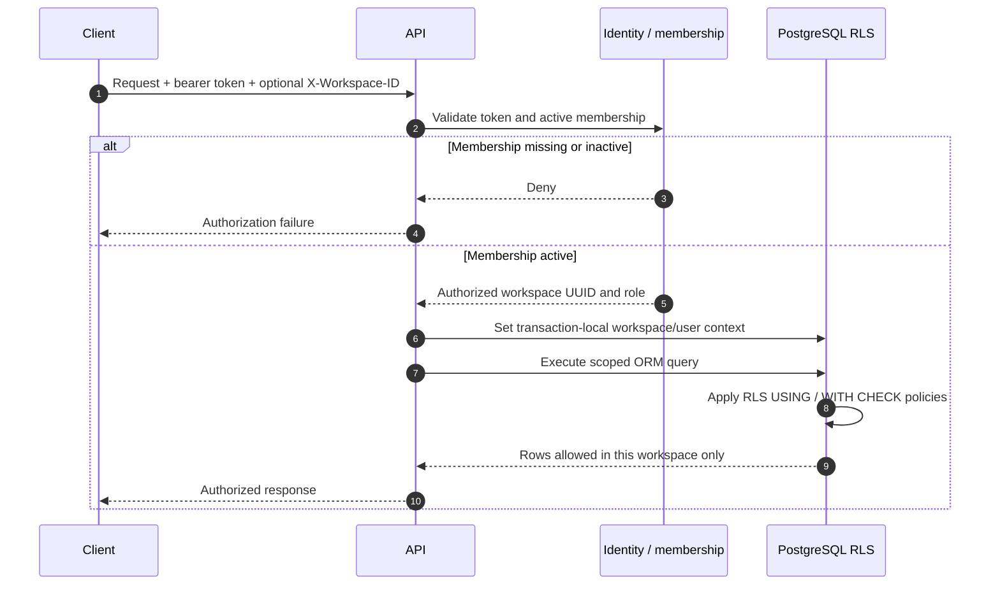
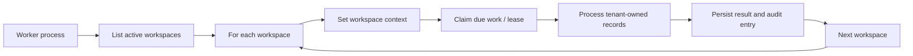

# Workspace identity and isolation

Workspace identity is now part of the request, persistence and worker model. This document describes the enforced boundary introduced by migrations `0015_workspace_identity` and `0016_tenant_isolation`.

## Identity model

- `workspaces` stores the workspace UUID, unique slug, display name and active state.
- `workspace_memberships` binds a user to a workspace with an explicit workspace role and active state.
- Migration `0015_workspace_identity` creates the default workspace and backfills existing users and records without discarding the pre-existing SOC data.
- Authenticated requests resolve the caller's active membership. A multi-workspace user selects an active workspace using `X-Workspace-ID`; the header alone never grants access.
- Workspace administration and membership changes are protected by the relevant administrative permissions and are audited.

## Request path



The ORM layer adds workspace criteria to tenant-owned models and assigns workspace ownership to new records. PostgreSQL RLS independently enforces row visibility and write checks. Database constraints/triggers also reject cross-workspace references in relationships that connect records, including case/alert links, asset findings, connector state and response records.

## Background workers

The scheduler, retention, integration and response workers do not run with an unrestricted tenant-wide ORM session. They enumerate active workspaces, set an explicit workspace context, and process due work within that context. PostgreSQL locking and durable leases coordinate competing worker replicas.



## Database enforcement

The API and workers connect as the dedicated `aegis_runtime` role. It is a `NOSUPERUSER`, `NOBYPASSRLS` role; migrations run through the separate owner connection. Row-level security is enabled and forced on tenant-owned tables. Workspace context is transaction-local, so it does not intentionally leak between pooled database transactions.

Do not grant the runtime role table ownership, superuser privileges or `BYPASSRLS`. Doing so would undermine the database enforcement boundary. Do not use the migration-owner URL as the application `DATABASE_URL` in production.

## Verification

The PostgreSQL integration tests exercise the real policy boundary, including cross-workspace reads and writes, membership visibility and cross-workspace relationship rejection. The ordinary SQLite suite remains useful for fast application-level regression tests, but SQLite does not implement PostgreSQL RLS and cannot prove database isolation.

For a local verification run:

```powershell
docker compose up --build -d db api
docker compose exec api alembic current
docker compose exec api alembic heads
docker compose exec api pytest -q tests/test_postgres_rls.py
```

The current migration head is `0019_sigma_correlation`. The PostgreSQL RLS test requires the repository's configured test database environment; if the test reports that its PostgreSQL URL is absent, configure the dedicated CI/test database rather than pointing the test at a production database.

## Operational constraints

- A user must have an active membership for the selected workspace.
- Workspace IDs are identifiers, not secrets or authorization tokens.
- Every tenant-owned table, child relationship, uniqueness key and background job must remain workspace-scoped as the schema evolves.
- New migrations that add tenant-owned tables must add the corresponding RLS policy and PostgreSQL regression coverage in the same change.
- Backup and restore procedures must preserve workspace memberships, ownership columns and RLS policies.
